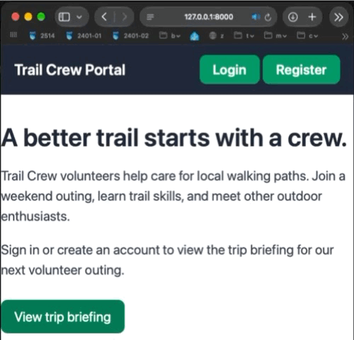
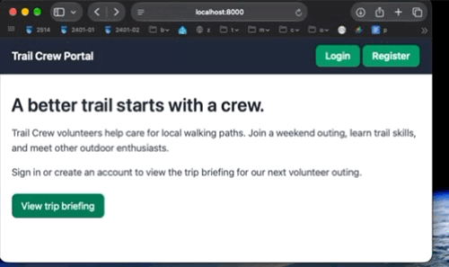
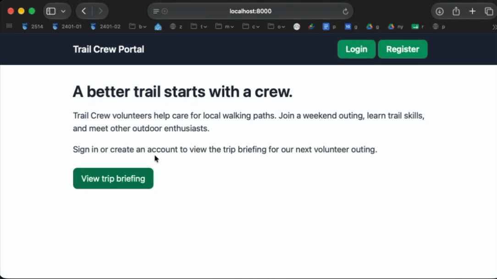
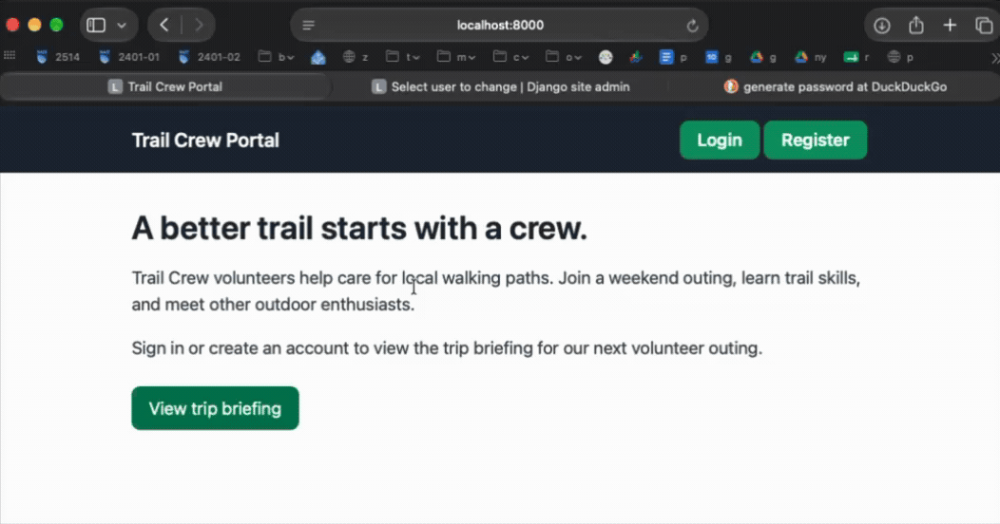

# SDEV 2401 - Lab 3 Prep Exercise - Trail Crew Portal

Practice authentication and authorization in a Django web application before completing Lab 3.

You have been tasked with securing a volunteer hiking club's Trail Crew Portal. Visitors can read the public home page, while registered volunteers should be able to access a private trip briefing. Users should be able to register, log in, and log out.

The goal is to protect `/briefing/` so that only authenticated users can access it. Unauthenticated visitors should be redirected to the login page.

## Instructions

### Part 1: Implement Authentication for the Trail Crew Portal app

1. Open a terminal in `trail_crew_project/`. Create a virtual environment and install dependencies from requirements.txt,  create a superuser and run the development server:

2. Secure the "briefing/" route so that only the authenticated users can access it.

3. Update the `trail_crew_project/settings.py` file to set the login redirect URL to the briefing page after a successful login.
   - the login redirect URL should be set to `/briefing/`
   - the logout redirect URL should be set to `/`
   - the login URL should be set to `/core/login/`

4. in the `templates/base.html` file, update the template for the registration url with the correct Django template tag to point to the registration page.

Note: Please take a look at the Desired output section for what the final output for this part should look like.

### Part 2: Implement the login and logout functionality

1. In the `core/templates/core/login.html` file, implement the login form using Django's built-in authentication views and forms.
   - Embed the CSRF token in the form.
   - Render the form fields using `{{ form.as_p }}`.

2. In the `core/urls.py` file, add the necessary URL patterns to handle user registration, login, and logout using Django's built-in authentication views.
    - The login path should be `login/` with the name `login`
        - this should use the `LoginView` import
    - The logout path should be `logout/` with the name `logout`
        - this should use the `LogoutView` import
Important Note: that in the `trail_crew_project/urls.py` file, the authentication URLs are already included under the `core/` path.

3. In the template `templates/base.html` update the login and logout links that point to the correct Django template tags.
   - for login template tag you can use the name of the route you defined in the previous step. The template tag should look like this: `` where `NAME_OF_ROUTE_HERE` is the name you defined in the `core/urls.py` file.
   - For the logout form Embed the CSRF token in the form.

4. Test that login and logout functionality works with your superuser account.

   - A user should be able to login at `/core/login/` and logout at `/core/logout/`.
   - the user should be able to click the links in the navigation bar to login and logout.

Note: Please take a look at the Desired output section for what the final output for this part should look like.

### Part 3: Implement the registration functionality

0. In the `core/views.py` file take a look at the `register` view function. This view is already partially implemented for you. You need to complete the implementation to handle user registration using Django's built-in `UserCreationForm`.

1. In the template `core/templates/core/register.html`, implement the registration form.
    - Embed the CSRF token in the form.
    - Observe
      - how the form fields are rendered using a for loop to iterate over each field in the form.
      - how errors are displayed for each field using `{{ field.errors }}`.

2. Check if the request method is POST. If it is, create an instance of `UserCreationForm` with the submitted data (`request.POST`).

3. Check if the form is valid using `.is_valid()`. If it is valid, save the new user to the database using `.save()`.

4. After saving the user, redirect them to the login page using `redirect('login')`.

5. Test the registration functionality by creating a new user account and log into that account.

Note: Please take a look at the Desired output section for what the final output for this part should look like.

## Desired Output

### Part 0: The initial state, unprotected

### Part 1: Protect the trip briefing

The login route is implemented in Part 2, so a route-not-found error at this stage is expected.

### Part 2: Implement login and logout

### Part 3: Implement registration

## Challenge (optional)

Customize the registration form to collect an email address, first name, and last name. Update the registration view and template to handle these additional fields.
